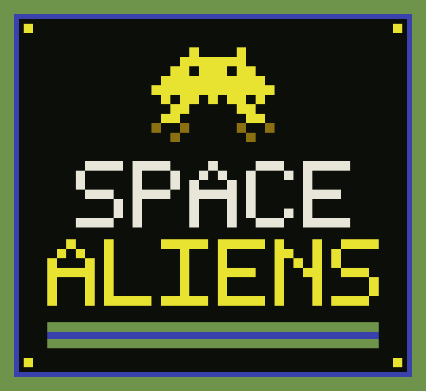

  

  A browser space shooter, in the spirit of the 1980 Atari one-player game. 
  Original pixel art and synthesized sound. Not the cartridge.

## How to play

Three hits, or one invader reaching the ground, and the game is over. Thirty-six invaders stand in six rows of six. Clear them and the next wave starts closer to the ground, until it is as low as it goes. The cannon fires one beam at a time. Press again once the beam is gone. On a phone, hold FIRE and it shoots again as soon as it can.

The three shields chip away where a beam or a bomb hits them. When the invaders get close, the shields vanish. The command ship crosses the top now and then, from either side. It does not shoot. It is worth 200, and the score hides while it is on screen.

| Key | Action |
| --- | --- |
| `←` `→` or `A` `D` | Move |
| `Space`, `↑`, `Z`, or `X` | Fire |
| `Enter` | Start |
| `P` | Pause |
| `M` | Mute or unmute |

On a phone, the buttons sit on the screen. Dragging on the picture moves the cannon. A gamepad works too: the pad moves, a button fires.

| Target | Points |
| --- | --- |
| Bottom row | 5 |
| Next rows, going up | 10, 15, 20, 25 |
| Top row | 30 |
| Command ship | 200 |

A full wave of invaders is 630 points. The point value stays with the row it started in. The best score stays saved in this browser.

The sound is the four-note march, and it speeds up as the wave thins out. The cannon shot, an invader hit, your cannon exploding, a chip off a shield, and the command ship each have their own sound.

## Files

`index.html` is the page. `css/style.css` is the look. `js/game.js` is the game. `assets/` holds the logos.

Opening `index.html` from disk is enough. There is no room and no multiplayer.

  

